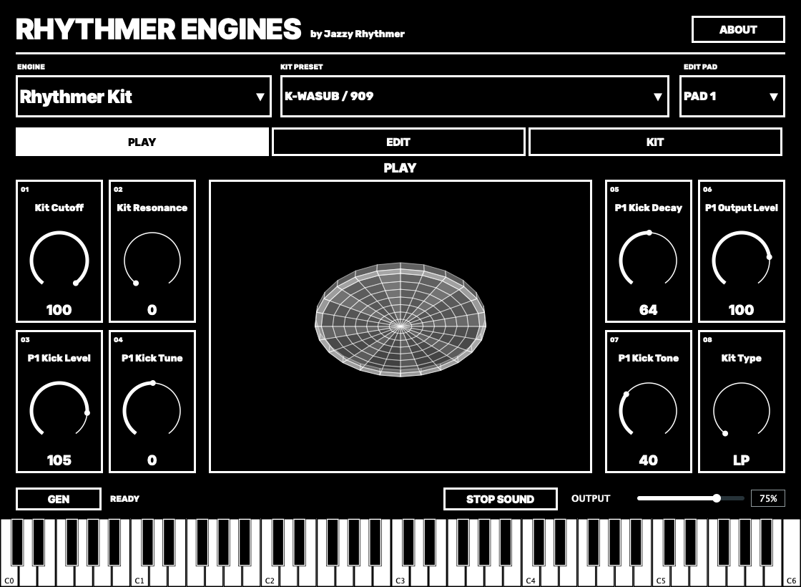

# RHYTHMER ENGINES for Mac

**Find a sound. Shape it. Build a pattern.**

20 sound engines, 36 Rhythmer Kits and 2,707 synth preset selections in one
instrument. By Jazzy Rhythmer. **0.1.0 · Early Beta**.

[Website & installation](https://jazzyrhythmer.github.io/mac/#release) ·
[Download AU + VST3](https://github.com/jazzyrhythmer/rhythmer-engines/releases/tag/v0.1.0) ·
[First session](https://jazzyrhythmer.github.io/mac/#guide)

## Compatibility

- Apple Silicon Mac, macOS 13 or later.
- Audio Unit (AU) and VST3 instrument hosts.
- This ZIP uses ad-hoc signing. It is not Developer ID-signed or Apple-notarized;
  macOS or your DAW may block it. See the installation guide if that happens.

## Install

1. Download and extract the **AU + VST3 ZIP** from the release page. Quit your DAW.
2. In Finder, choose **Go → Go to Folder** (`Shift–Command–G`).
3. Copy `AU/Rhythmer Engines.component` to
   `~/Library/Audio/Plug-Ins/Components/`.
4. Copy `VST3/Rhythmer Engines.vst3` to `~/Library/Audio/Plug-Ins/VST3/`.
   Create the destination folders if needed. You can install either format or both.
5. Reopen/rescan your DAW. Add **Rhythmer Engines** to a MIDI instrument track.

Copy the **complete .component/.vst3 bundle**, not the files inside it. Keep one
installation location for each format: an older system-wide copy under
`/Library/Audio/Plug-Ins/` may otherwise be scanned instead.

Start with **Rhythmer Kit / K-WASUB / 909**. Play MIDI notes **36–51** for its pads,
or select an individual synth with ENGINE and choose a sound with PRESET.

If it does not appear, check the plug-in folder, native Apple Silicon host mode
and the host's AU/VST3 settings, then rescan. For a macOS security message, review
[Apple's Privacy & Security guidance](https://support.apple.com/102445).

## Work with the sound

- **PLAY:** eight main controls and the engine's original 3D animation.
- **EDIT:** full sound, modulation and FX controls, grouped across compact pages.
- **KIT:** 4×4 pads; replace and edit the selected pad's engine and sound.
- **GEN:** create Melody, Chords or Drums MIDI patterns; drag/export the MIDI into
  your DAW for playback at its tempo. There is no separate internal sequencer.
- **ABOUT:** original credits and creator links.

Save your DAW project to retain the instrument state. STOP SOUND releases held
sound; DAW transport stop also clears held notes and sustain. See [GUIDE.md](GUIDE.md).

## Engines

Rhythmer Kit, Sophie, Elixir, Aphex, FM-106, FMini-1, CS-1, OberVave, K-WASUB,
Hera, Braids, Plaits, Hortator, MONO2K, Prophet, S1Vave, Dexed, Guru-600,
Frodhes and Tenebrae.

[Hear the engines](https://jazzyrhythmer.github.io/mac/#engines) ·
[Original authors and licences](CREDITS.md)

## Source and licences

This repository contains the matching build-source snapshot, including the
custom frontend, native adapters, original engine inputs, JUCE and runtime data.
See [BUILDING.md](BUILDING.md) to build it. A matching full-source ZIP is also
provided with the binary release.

Rhythmer integration is AGPL-3.0; each bundled component retains its own licence
and copyright notices. Read [LICENSE](LICENSE), [CREDITS.md](CREDITS.md), and the
original LICENSE/COPYING/NOTICE files. Retained Melodee components are credited
to Kerem Kilic / Ellic Studio. Engine source identities and notices are also in
`resources-template/SOURCE-INDEX.json` and `resources-template/Licenses/`.

## From the studio

In search of feel-good rhythms. Music, instruments & open-source firmware.
Building JR Audio Software.

[YouTube](https://www.youtube.com/@jazzyrhythmer) ·
[Instagram](https://www.instagram.com/jazzyrhythmer/) ·
[Support on Ko-fi](https://ko-fi.com/jazzyrhythmer) ·
[Patreon](https://www.patreon.com/JazzyRhythmer/) ·
[Contact](mailto:jazzyrhythmer@gmail.com)
